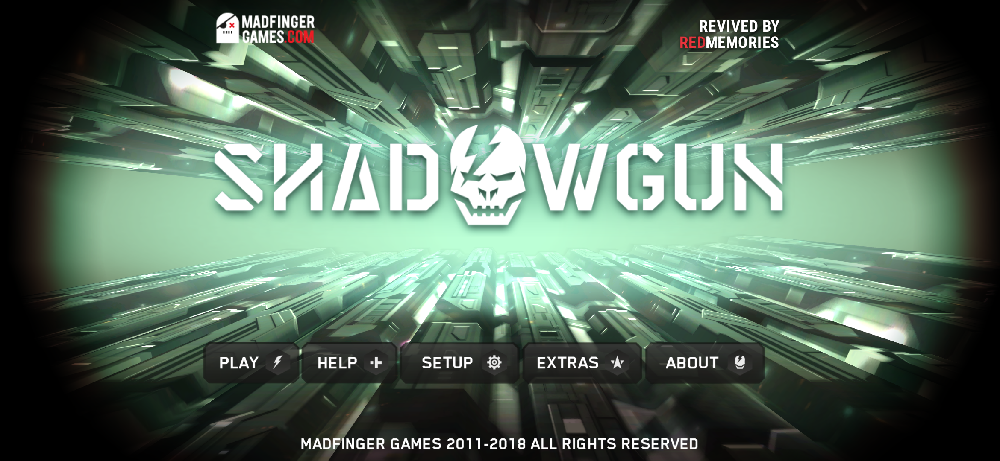
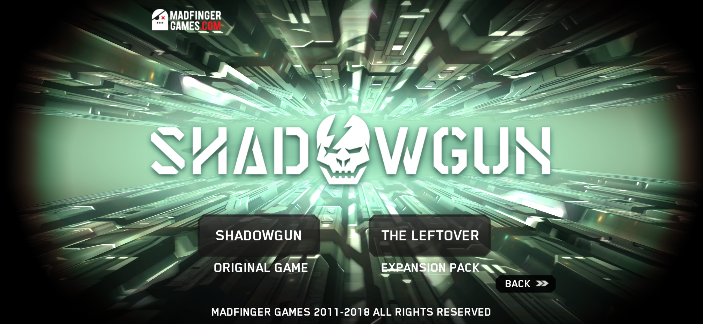
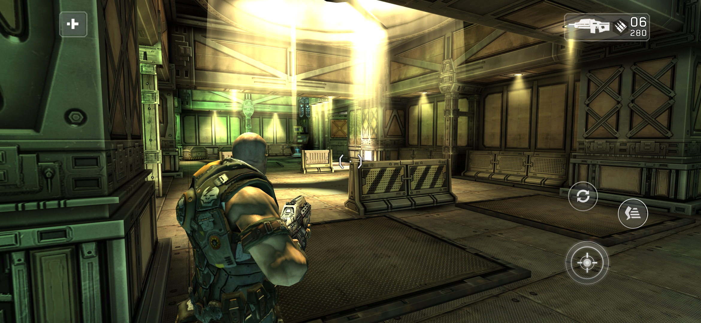

# SHADOWGUN Revived

> SHADOWGUN is by Madfinger Games. This is a non-commercial fan project, not affiliated with Madfinger Games. The game was pulled from the stores years ago. This repo is my private archive, please don't share the release files.

## What I did

I didn't remake the game and I didn't touch the gameplay. The campaign, the expansion pack THE LEFTOVER, the levels and the story are exactly the ones from the last release, 1.7.0.

SHADOWGUN is a Unity game, and its engine and all of its game code were built only for 32-bit phones, which today's phones can't run anymore. As with The Dark Knight Rises and the Spider-Man games, I recompiled the whole thing to 64-bit code ahead of time: 70,592 of its 70,610 functions, across Unity's engine and the game's own code, rebuilt for today's phones. While you play, every call runs in the recompiled code, so the game runs as a modern app.

Once it was running:

- full screen on today's tall displays, at the full resolution of the screen, with the menu backgrounds widened to fill the wider screen
- the highest graphics quality the game has on powerful phones, plus 4x anti-aliasing on Snapdragon phones and 32-bit color instead of 16-bit; a GRAPHICS button in the main menu and in the pause menu lets you pick AUTO, LOW, MEDIUM, HIGH or MAX if your phone can't hold 60 fps
- runs smoothly at 60 fps
- works fully offline: no Google Play login, no analytics, no advertising ID, and the game doesn't ask for any permission. The only thing that goes online is a check for new releases on this page, at most once a day, with no personal data; when there's a new version, the main menu tells you
- today's controllers work out of the box (I tested an Xbox controller), with START to pause
- the game data is packed inside the APK, so there's nothing to download separately

## Install

1. Download the APK from **Releases**
2. Install it
3. Open it. The first launch takes a moment to prepare the game files, after that it starts right away

No PC, no extra downloads, no account.

## Requirements

- 64-bit Android phone with Android 10 or newer
- about 1 GB of free space

I play it on a Galaxy S26 Ultra with Android 17. I haven't tried it on phones without a Snapdragon chip yet (MediaTek Dimensity, Exynos, Google Tensor): if you play on one of them, let me know how it runs.

## Credits

Revived by **RedMemories**

Thanks to the [dynarmic](https://github.com/azahar-emu/dynarmic) project: its ARM decoder is the base of the recompiler, and it still runs the few bits of the engine that aren't recompiled.

Original game by Madfinger Games.

## ☕ Support my work

If you enjoy my projects and would like to support my work, you can buy me a coffee on Ko-fi! Every project I create is and will always remain free, but any support is greatly appreciated and helps me keep working on new projects and improvements.

Thank you for your support! ❤️

[ko-fi.com/redmemories_ita](https://ko-fi.com/redmemories_ita)
